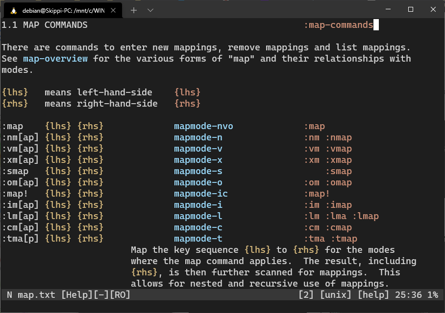

Vim is notorious for allocating commands to nearly every key on the keyboard (just try calling `:help` on almost any key). While this is good in its own way, it leaves a shortage of keys that can be used in custom mappings. We can use a dedicated leader key, like `\` or `<Space>`, to shelve our mappings under, but this causes our leader key to overcrowd very quickly. One work around is to map around existing functionality.



## Unused "Marks"

It's possible to use `m` as an alternative leader key in some instances. `m` only places marks for alpha-numeric keys along with `` ' " ` [ ] < > ``. This leaves quite a few unused key sequences, some of which is listed below:

```vim
m! m( m) m= m{ m} m; m: m, m. m/ m? m<CR> m<Space> m<BS>
```

Examples:

```vim
" substitute forwards and backwards
nnoremap m, #NcgN
xnoremap m, "zy?\V<C-R>=escape(@z,'/\')<CR><CR>NcgN
nnoremap m; *Ncgn
xnoremap m; "zy/\V<C-R>=escape(@z,'/\')<CR><CR>Ncgn
```

```vim
" :make mappings
nnoremap m= :set makeprg=
nnoremap m<Space> :make<Space>
nnoremap m<CR> <Cmd>make<CR>
nnoremap m? :help makeprg<CR>
```

We can apply similar logic to the `'` and `` ` `` commands. Although these two certainly have fewer options:

```vim
'! '@ '# '$ '% '<Tab> '<Space>
```

Examples:

```vim
" jump to special files (vimrc, indent file, etc.)
nnoremap '$ :sp <C-r>=stdpath('config')<CR>/init.vim<CR>
nnoremap '<Tab> :sp <C-r>=stdpath('config')<CR>/after/indent/<C-r>=&filetype<CR>.vim<CR>
```

## Numeric Mappings

While not foreign to vim, I think this concept is worth mentioning. It's possible to bind different functionality to a mapping depending on if a number is used with it or not. This allows us to layer additional functionality on a command without entirely removing it. Here is an example with `<C-l>`:

```vim
" redraw the screen
" using a number additionally edits the buffer
noremap <expr> <C-l>
      \ (v:count ? '<Cmd>edit<CR>' : '')
      \ . '<Cmd>noh<CR>'
      \ . (has('diff') ? '<Cmd>diffupdate<CR>' : '')
      \ . '<Cmd>redraw<CR>'
```

## Operator-to-Operator Mappings

We can map operator-to-operator key sequences without breaking vim defaults. This is because vim only focuses on the operator-to-motion concept for much of its editing, such as `diw`, `daw`, `dw`, `d]}`. There's a lot of possibilities, so I'll leave only a few here for ideas:

```vim
dc ds dy d! d= d< d> yc yd yo ys y! y= =p =P cd cs co cp
```

Examples:

```vim
" vim-surround default mappings
nnoremap cs <Plug>Csurround
nnoremap ds <Plug>Dsurround
nnoremap ys <Plug>Ysurround
```

```vim
" paste and indent
nnoremap =p p=']
nnoremap =P P=']
nnoremap =gP gPmz'[=']`z
nnoremap =gp gpmz'[=']`z
```

```vim
" change directory
nnoremap cd <Cmd>tcd %:p:h<CR>
```

## Unused Bracket Mappings

Most key sequences involving `[ ]` are unused under default vim settings. Credit to tpope for popularizing this idea with `vim-unimpaired`:

```vim
" vim-unimpaired
nnoremap [q <Cmd>cprev<CR>
nnoremap ]q <Cmd>cnext<CR>
nnoremap [t <Cmd>tprev<CR>
nnoremap ]t <Cmd>tnext<CR>
```

```vim
" cycle between quickfix lists
nnoremap [<M-q> <Cmd>exe "sil!uns colder" v:count1<CR>
nnoremap ]<M-q> <Cmd>exe "sil!uns cnewer" v:count1<CR>
```

## Unused `g` and `z` Mappings

The built in `g` and `z` leaders also have some unused key sequences, some of which I will list here. Use `:help` to discover other unused keys:

```vim
nnoremap g<CR> <Cmd>Git<CR>
nnoremap g<Space> :Git<Space>
nnoremap g. <Cmd>Gvdiffsplit<CR>
nnoremap g/ :sil!gr<Space>
nnoremap g! <Cmd>FzfProcKill<CR>
xnoremap g& <Esc><Cmd>'<,'>&&<CR> " note visual mapping
nnoremap z/ <Cmd>BLines<CR>
```

## Effectively "Unused" Commands

Some keys are mapped to vim and are "useless" to an extent. These keys are either not useful or are superseded by existing commands. Note that this section is subjective, so the number of available keys will vary depending on the person. Here are some that I remap since I rarely use them:

```vim
" <Space> <CR> ' _ Q d<CR> d<Space> gh gs s S
```

```vim
noremap ' `
nnoremap _ <Cmd>sil !xdg-open "%:p:h"<CR>
noremap gh ^
nnoremap gs :sil!gr \b<C-r>=escape(expand('<cword>'), '%#"')<CR>\b<CR>
```

Always check `:help` on these commands before trying to replace them, as it's a good idea to understand what's being replaced.

## Unused Keys from `map.txt`

We can also check `:help map-which-keys`, which already lists a couple of mapping ideas. These are pretty simple but worth mentioning in case all else fails. Special mention to `<M->` mappings.

## Conclusion

Using some clever thinking, it's possible to squeeze in some custom mappings that don't use our primary leader keys. There's more possible key sequences than listed here, so be sure to think about them.
